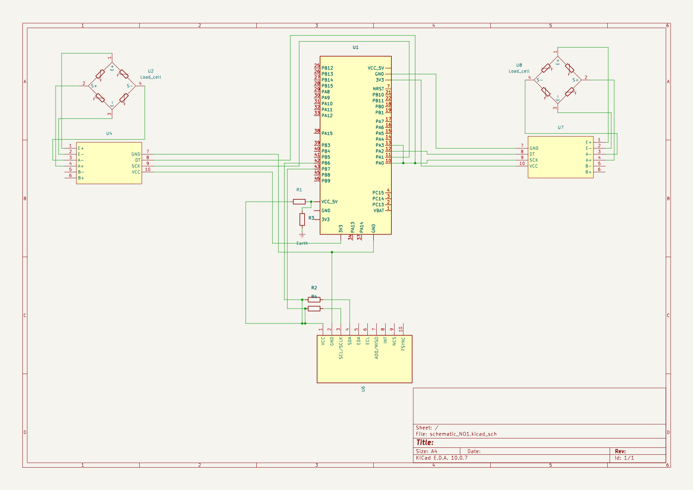
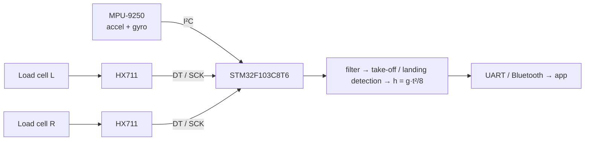

# 🏀 Jump Analyzer — IMU + force‑plate wearable

**Measures vertical jumps: flight time from a 9‑DOF IMU, take‑off / landing force from two load cells.**

> **RU:** Носимое устройство для анализа прыжка: время полёта по IMU, сила отталкивания и приземления по двум тензодатчикам.
> **TR:** Dikey sıçrama analizi için giyilebilir cihaz: IMU ile uçuş süresi, iki yük hücresi ile kalkış ve iniş kuvveti.

 
KiCad schematic (<a href="docs/schematic.pdf">PDF</a>): STM32F103C8T6 (U1), MPU‑9250 on I²C with pull‑ups (U6), 2× HX711 (U4, U7) with full‑bridge load cells (U2, U8).

---

## 🧠 How it measures

Flight time $t$ = time between take‑off and landing (IMU acceleration ≈ free fall, then impact spike). Jump height:

$$
h = \frac{g\,t^2}{8},\qquad g = 9.81\ \text{m/s}^2
$$

The load cells add what the IMU cannot see well: peak take‑off force, landing impact and left/right symmetry.

## 🔧 Hardware

| Ref | Part | Role |
|---|---|---|
| U1 | STM32F103C8T6 ("Blue Pill") | MCU |
| U6 | MPU‑9250 | 9‑DOF IMU, I²C (SCL/SDA with pull‑ups R2, R4) |
| U4, U7 | HX711 | 24‑bit bridge ADC for each load cell |
| U2, U8 | full‑bridge load cell | force under each foot |

## 📂 Files

| Path | What |
|---|---|
| `hardware/kicad/` | KiCad project, schematic, MPU‑9250 and load‑cell symbols |
| `docs/schematic.pdf`, `.png` | exported schematic |

## 🛣️ Roadmap

- [x] Schematic: MCU, IMU, two load‑cell channels
- [ ] PCB layout (wearable size), power (Li‑ion + 3.3 V LDO)
- [ ] Firmware: IMU at ≥ 500 Hz, HX711 read, jump detection
- [ ] Validation against a camera / force plate, then Bluetooth + app
